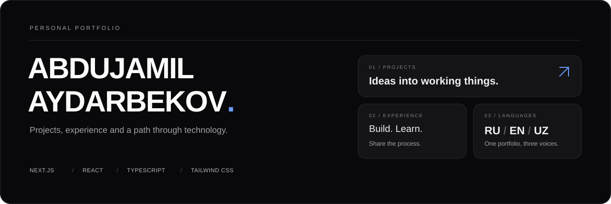

<p align="center">
  
</p>

<h1 align="center">Abdujamil · Portfolio</h1>

<p align="center">
  Личное портфолио: проекты, опыт и путь в IT.<br />
  Тёмный интерфейс с карточками, три языка и всё важное в одном месте.
</p>

<p align="center">
  <a href="https://abdujamil-portfolio.vercel.app"><strong>Открыть сайт ↗</strong></a>
  &nbsp; · &nbsp;
  <a href="public/Abdujamil.pdf">Резюме PDF</a>
  &nbsp; · &nbsp;
  <a href="https://t.me/Jamilf1">Связаться</a>
</p>

<p align="center">
  
  
  
  
</p>

<p align="center">
  <a href="#о-проекте">О проекте</a> ·
  <a href="#возможности">Возможности</a> ·
  <a href="#запуск">Запуск</a> ·
  <a href="#как-изменить-под-себя">Настройка</a> ·
  <a href="#структура">Структура</a>
</p>

---

## О проекте

Этот сайт собирает мою работу и обучение в одном месте: разработку интерфейсов, бизнес- и системный анализ, проекты для сообщества и участие в хакатонах. Здесь можно познакомиться со мной, посмотреть проекты и скачать резюме.

Контент хранится отдельно от интерфейса — в [`src/data/profile.ts`](src/data/profile.ts). Из одного источника берутся сведения о проектах, опыте, образовании и контактах на русском, английском и узбекском языках.

## Возможности

| Что есть | Как работает |
| --- | --- |
| **Три языка** | RU / EN / UZ; выбор сохраняется между посещениями. |
| **Карточки проектов** | Описание задач, стек и ссылки на код, демо или Telegram-бота. |
| **Опыт и образование** | Участие в хакатонах, волонтёрство и пройденное обучение. |
| **Меню быстрых действий** | `⌘ K` на macOS или `Ctrl K` на Windows и Linux. |
| **Резюме и контакты** | PDF-версия CV, GitHub, Telegram и электронная почта. |
| **Адаптивный интерфейс** | Карточки перестраиваются под ширину экрана; анимации учитывают настройку уменьшения движения. |

### Проекты в портфолио

- **Yoshlar Bandligi — GovTech 2.0.** Система мониторинга занятости молодёжи: ГИС-карта, аналитика и Telegram-интеграция. [Репозиторий →](https://github.com/fluxo159/NEXUS30-GovTech-2.0)
- **S21 Rooms.** Telegram Mini App для бронирования учебных комнат School 21. [Репозиторий →](https://github.com/fluxo159/school21-bot)
- **FurniCatalog.** Каталог мебели с навигацией по ассортименту и оформлением заявок.
- **BSA Study Case.** Учебный кейс по бизнес- и системному анализу.

## Стек

**Next.js 16** и **React 19** отвечают за приложение, **TypeScript** — за типы, **Tailwind CSS 4** — за оформление. **Framer Motion** используется для анимаций, **Lucide React** — для иконок. Шрифты Archivo и Space Grotesk подключаются через `next/font`.

## Запуск

Нужны **Node.js 20.9+** и **npm**.

```bash
git clone https://github.com/fluxo159/abdujamil-portfolio.git
cd abdujamil-portfolio
npm ci
npm run dev
```

Откройте [localhost:3000](http://localhost:3000). Отдельный сервер данных и переменные окружения для локального запуска не нужны.

| Команда | Назначение |
| --- | --- |
| `npm run dev` | Локальный сервер с обновлением при изменении файлов. |
| `npm run build` | Production-сборка. |
| `npm start` | Запуск собранного приложения. |
| `npm run lint` | Проверка кода ESLint. |

## Как изменить под себя

| Что обновить | Где искать |
| --- | --- |
| Имя, фото, контакты и адрес сайта | [`src/data/profile.ts`](src/data/profile.ts): `name`, `avatar`, `links`, `siteUrl`. |
| Тексты, проекты, опыт и образование | Там же: `locales.ru`, `locales.en`, `locales.uz`. |
| Язык по умолчанию | `defaultLocale` в `profile.ts`. |
| Резюме PDF | [`public/Abdujamil.pdf`](public/Abdujamil.pdf) и `links.cvUrl` в `profile.ts`. |
| Главную страницу и компоновку карточек | [`src/app/page.tsx`](src/app/page.tsx). |
| Цвета, фон и общие стили | [`src/styles/globals.css`](src/styles/globals.css). |
| Страницы отдельных проектов | [`src/components/ProjectDetails.tsx`](src/components/ProjectDetails.tsx). |
| Заголовки страниц и Open Graph | [`src/app/layout.tsx`](src/app/layout.tsx). |

Перед публикацией укажите свой домен в `profile.siteUrl`: сейчас в исходном коде стоит `https://example.com`. Это значение используется для метаданных и ссылок Open Graph. При сборке `next/font` также загружает шрифты из Google Fonts, поэтому нужен доступ к сети.

## Структура

```text
src/
├── app/
│   ├── layout.tsx             # Метаданные, шрифты и провайдер языка
│   ├── page.tsx               # Главная страница портфолио
│   └── projects/[slug]/       # Страницы проектов
├── components/
│   ├── LanguageProvider.tsx   # Язык интерфейса и его сохранение
│   ├── CommandPalette.tsx     # Меню Cmd/Ctrl + K
│   └── ProjectDetails.tsx     # Описание отдельного проекта
├── data/
│   └── profile.ts             # Контент и локализации
└── styles/
    └── globals.css            # Тема и общие стили
public/
├── Abdujamil.pdf              # Резюме
├── cv_abdujamil.html          # HTML-версия резюме
└── og.svg                    # Изображение Open Graph
```

---

<p align="center">
  <strong>Абдужамил Айдарбеков</strong><br />
  <a href="https://github.com/fluxo159">GitHub</a> ·
  <a href="https://t.me/Jamilf1">Telegram</a> ·
  <a href="mailto:aydarkurbanbaev1406@gmail.com">Email</a>
</p>
